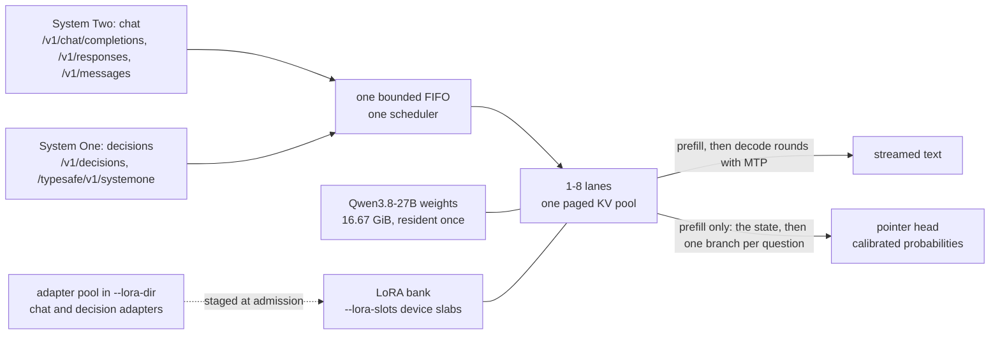

# NInfer-4090

<table>
<tr><td>
<p><b>A local model fixes the bug</b><br>
Qwen3.8-27B on <a href="https://github.com/tensorninja/ninfer-4090">ninfer-4090</a> uses the same tools and permission rules as a hosted model.<br>
<sub>Model: <code>ninfer-4090/qwen3.8-27b</code> · <a href="https://caudra.ai/docs/providers/#providers-toml">Custom providers</a> · <a href="https://caudra.ai/gallery/#local">Full session</a></sub></p>
<a href="https://caudra.ai/gallery/#local"><picture>
  <source media="(prefers-reduced-motion: reduce)" srcset="https://caudra.ai/readme/local-still.webp?v=3">
  
</picture></a>
</td></tr>
</table>

NInfer-4090 runs **Qwen3.8-27B** on one 24 GB NVIDIA GeForce RTX 4090. It is a C++20/CUDA inference
engine written from scratch, with no PyTorch, TensorRT, or llama.cpp underneath, and every kernel is
tuned for this one model on this one card.

The clip above is [Caudra](https://caudra.ai) running on it. The bar above the input is the live
prefill rate that NInfer streams while it reads the prompt.

- **Fast prefill and fast decode.** Prefill runs at 3,600 tok/s on a 9K-token prompt and still
  2,578 tok/s at 118K tokens. MTP speculative decoding reaches 148.6 tok/s on one code stream, and
  three concurrent streams decode at 299 tok/s together. The full native 262,144-token context
  fits on the card. [Speed](#speed-on-one-rtx-4090)
- **Works with any coding agent.** NInfer serves OpenAI Chat Completions, OpenAI Responses, and
  Anthropic Messages with streamed tool calls and reasoning control. Agents that resend a long,
  growing prompt every turn get it back from a tiered prefix cache instead of a fresh prefill.
  [Any coding agent](#use-it-from-any-coding-agent)
- **Works best with Caudra.** Caudra shows the live prefill rate, marks cache breakpoints that
  NInfer honors, and uses the same server as its decision engine.
  [Caudra](#use-it-from-caudra)
- **LoRA adapters per request.** Put adapter files in a directory and every one of them becomes a
  model name. Requests pick an adapter by name, adapters swap into a small set of GPU slots on
  demand, and requests for different adapters decode in one batch.
  [LoRA adapters](#load-lora-adapters-per-request)
- **Two decision APIs on the same weights.** The same process answers OpenAI's `POST /v1/decisions`
  and TypeSafe's System One API (the JEV protocol). A decision adapter returns calibrated
  probabilities by prefill alone, about 100 ms for six questions on a cached state.
  [Decisions](#decisions-openai-and-typesafe-system-one)
- **Two adapters to start with.** `caveman-1` (a chat style adapter) and `decision-1` (a decision
  adapter) are published on Hugging Face. [Get the adapters](#get-caveman-1-and-decision-1)

## Quick start

These steps run the server in Docker with the full 262,144-token context and connect an agent to
it. You need an RTX 4090, NVIDIA driver 580 or newer, and Docker with the
[NVIDIA Container Toolkit](https://docs.nvidia.com/datacenter/cloud-native/container-toolkit/latest/install-guide.html).

1. Start the server:

   ```bash
   docker run --detach --name ninfer --gpus all --publish 8080:8080 \
     --volume ninfer-assets:/var/lib/ninfer \
     --volume ninfer-cache:/var/cache/ninfer \
     ghcr.io/tensorninja/ninfer-4090:latest
   ```

   On first start the container downloads the 17 GB
   [model](https://huggingface.co/tensorninja2/Qwen3.8-27B-NInfer) and the
   [`caveman-1`](https://huggingface.co/tensorninja2/caveman-1) and
   [`decision-1`](https://huggingface.co/tensorninja2/decision-1) adapters into the
   `ninfer-assets` volume and checks their SHA-256. Later starts reuse them. The server checks GPU
   memory before it listens on port 8080. `docker logs --follow ninfer` shows the download and
   startup.

2. Send a request:

   ```bash
   curl -s http://127.0.0.1:8080/v1/chat/completions -H 'content-type: application/json' -d '{
     "model": "qwen3.8-27b", "enable_thinking": false,
     "messages": [{"role": "user", "content": "Say hello in five words."}]}'
   ```

   The dashboard is at `http://127.0.0.1:8080/`.

3. Connect your agent. OpenAI clients use the base URL `http://127.0.0.1:8080/v1` and Anthropic
   clients use `http://127.0.0.1:8080`, both with the model `qwen3.8-27b`. For Caudra, follow
   [Use it from Caudra](#use-it-from-caudra).

To change the server flags, use Docker Compose, or build the image yourself, see [Docker](#docker).
To build without Docker, see [Native build](#native-build).

## Speed on one RTX 4090

Measured on an RTX 4090 at its 480 W limit, CUDA 13.2, one request at a time unless the row says
otherwise, greedy decoding, CUDA Graphs on, `--prefill-chunk 1024`, and the official 16.96 GiB
Qwen3.8-27B artifact. Prefill rates come from the server's structured request log with prefix
reuse and the continuation cache off, so they count only tokens the GPU actually computed.

| Workload | Result | KV mode |
|---|---:|---|
| Prefill, 9,411-token prompt | **3,600 tok/s** | `rk4v4-e8` |
| Prefill, 37,798-token prompt | **3,250 tok/s** | `rk4v4-e8` |
| Prefill, 118,242-token prompt | **2,578 tok/s** | `rk4v4` |
| Decode, code generation, MTP with 3 draft tokens | **148.6 tok/s** at 81.0% draft acceptance | `int8` |
| Decode, mixed prose corpus, MTP3 | 106.5 tok/s at 48.7% acceptance | `int8` |
| Decode, 3 concurrent streams, MTP3, 8K-token prompts | **299 tok/s** together (94 for one, 200 for two) | not recorded |
| Decode at 128K depth, prose, MTP3 | 77.5 tok/s at 41.6% acceptance | `rk4v4-e8` |
| Decode, no speculation | 50.5 tok/s shallow, 39.6 tok/s at 128K depth | `int8` |

`rk4v4-e8` is the earlier 4-bit KV codec. The current `rk4v4` prefills 2.3% faster and decodes at
the same rate. MTP acceptance, and with it the decode rate, depends on how predictable the output
is: structured code accepts about 81% of draft tokens and mixed prose about 49%.

Three pieces of work carry these numbers:

- **INT8 tensor-core prefill.** All six dense GEMMs in the model body run on
  `mma.m16n8k32.s32.s8.s8.s32` during prefill, with group-64 INT8 activations. Prefill at 115K
  tokens went from 1,739 to 2,496 tok/s (1.435x). Decode keeps the BF16 routes, so its output is
  unchanged.
- **Tensor-core batched decode.** With MTP every round verifies four positions per stream, so
  three streams run the projections at 12 tokens. A shared small-batch MMA route keeps that round
  at 1.17x the single-stream round instead of 1.83x, which took three-stream decode from 172 to
  299 tok/s.
- **Ada-tuned attention prefill.** The INT8 attention prefill schedule is retuned for `sm_89`
  register limits and skips masking work on key blocks wholly below the causal diagonal. The kernel
  gained 30% at 64K tokens.

For scale, llama.cpp on the same card decodes the `UD-Q4_K_XL` GGUF of the same model at 118.8 tok/s
on shallow code with its own MTP drafting, against 142.9 tok/s here, and 42.3 against 77.5 tok/s
on prose at 128K depth. Its MTP buffers do not fit beyond a 131,584-token context. The prefill
comparison against llama.cpp predates the INT8 prefill routes and has not been re-measured, so this
README claims no prefill lead. The upstream engine on an RTX 5090 decodes the same code prompts at
172 tok/s at 400 W, and this card lands within 14% of it.

Method and raw numbers: [Performance](docs/performance.md#rtx-4090-sm_89-long-context-prefill) and
[NInfer against llama.cpp](docs/llamacpp-comparison.md).

## Use it from any coding agent

NInfer listens on one port, `http://127.0.0.1:8080` by default, and speaks three generation APIs:

| API | Endpoint | Use it with |
|---|---|---|
| OpenAI Responses | `POST /v1/responses` | agents and SDKs built on the Responses API, including streaming and stored `previous_response_id` continuations |
| OpenAI Chat Completions | `POST /v1/chat/completions` | most agents, editors, and proxies |
| Anthropic Messages | `POST /v1/messages` | agents built on the Anthropic API |

Point the agent's OpenAI or Anthropic base URL at the server, and use `qwen3.8-27b` as the model
name. A LoRA adapter adds its own model name, as described in
[Load LoRA adapters per request](#load-lora-adapters-per-request). The server needs no API key
unless you start it with `--api-key`.

The serving layer is built for agent traffic:

- **Long prompts come back from cache.** An agent resends its whole conversation every turn.
  NInfer resumes from the deepest compatible point it still holds, either in a GPU lane, in host
  RAM, or on disk, and prefills only the new tail. In one recorded agent session, 44 restores
  returned 2.76 million cached tokens. Recomputing them would have taken an estimated 22 to 42
  minutes.
- **History rewrites keep their cache.** Some clients rewrite the newest user message every turn,
  for example to append a reminder block. A second anchor upstream of that message keeps the
  earlier conversation reusable. On a 46.7K-token session with such a client, reuse went from 0 to
  46,552 tokens and time to first token from 16.7 s to 0.59 s.
- **Session routing.** `prompt_cache_key` routes a session to its own cached state, and explicit
  `prompt_cache_breakpoint` marks on Responses input publish content-addressed prefixes that other
  sessions can share.
- **Tool calls stream as they are generated.** Qwen's tool-call markup is parsed into OpenAI and
  Anthropic tool calls, with string arguments streamed incrementally.
- **Reasoning control.** The model has three trained reasoning depths and an off switch. Chat
  Completions takes `reasoning_effort` (`none`, `low`, `medium`, or `xhigh`) and `enable_thinking`,
  Responses takes `reasoning.effort`, and Anthropic Messages takes `output_config.effort` and
  `thinking`. Reasoning returns separately from the answer, as `message.reasoning_content` on Chat
  Completions and as native reasoning summaries on Responses. Sampling defaults follow the model
  card and change with the thinking mode.
- **Clients see the real limits.** `/v1/models` reports `context_window`, and Chat Completions
  responses carry a llama.cpp-compatible `timings` block with prefill and decode rates and draft
  acceptance. `GET /metrics` uses llama.cpp's Prometheus names, so existing scrapers and proxies
  such as llama-swap read it without changes.

Request and streaming contracts for every endpoint are in [HTTP serving](docs/serving.md).

## Use it from Caudra

[Caudra](https://caudra.ai) is a coding agent by the author of this fork. It works with NInfer as
it does with any other provider, and it uses three NInfer features that most clients ignore:

- **Live prefill progress.** While NInfer prefills a Responses request, it repeats
  `response.in_progress` with a `prompt_progress` object (`processed`, `total`, and `cache` tokens).
  Caudra turns it into the prefill-rate bar in the clip. Other clients ignore the extra field.
- **Cache breakpoints and session keys.** Caudra sends a `prompt_cache_key` per session and closes
  its system prompt with an explicit `prompt_cache_breakpoint`. NInfer routes the session to its
  cached state and publishes the system prompt and tools as a prefix that every new session reuses.
- **A local decision engine.** Caudra's decision engine sends typed questions to a decisions
  endpoint. Pointed at NInfer, it runs on `decision-1` in the same process and weights as the chat
  model. Caudra uses it for permission advice, Auto mode screening, shell effect predictions,
  content screening of tool results, subagent routing, and reranking of memory notes, code context,
  and history matches. Its `decisions.decide()` and `decisions.rerank()` calls work inside `code`
  snippets too.

Install Caudra with `curl -fsSL https://caudra.ai/install.sh | sh`, or see its
[quick start](https://caudra.ai/docs/quick-start/). Then add the server to
`~/.config/caudra/providers.toml`. The context window and output limit below add up to the
model's 262,144 tokens, so the largest prompt and output Caudra asks for always fit. They assume
the server runs with `--max-context 262144`, as the Docker image does.

```toml
[ninfer-4090]
display_name = "ninfer-4090"
protocol = "openai-responses"
base_url = "http://127.0.0.1:8080/v1"
api_key_env = "NINFER_4090_API_KEY"
discover_models = true

[ninfer-4090.model_defaults]
supports_thinking = true
supports_cache_breakpoints = true
context_window = 229376
max_output_tokens = 32768

[[ninfer-4090.model_defaults.reasoning_options]]
type = "effort"
values = ["none", "low", "medium", "xhigh"]

[decisions.ninfer]
protocol = "openai"
base_url = "http://127.0.0.1:8080/v1"
model = "decision-1"
```

Set `NINFER_4090_API_KEY` to any value, or to the key you passed to `--api-key`. Select
`ninfer-4090/qwen3.8-27b` (or an adapter such as `ninfer-4090/qwen3.8-27b-caveman-1`) in `/model`,
and switch decisions to `ninfer` with `/decision-model` or `caudra decisions use ninfer`. For a
server on another host, add `allow_http = true` to the decisions table and use a transport you
trust, such as an encrypted tunnel.

Caudra's documentation covers [custom providers](https://caudra.ai/docs/providers/#providers-toml),
[decision endpoints](https://caudra.ai/docs/providers/#decision-endpoints), and
[decisions in code snippets](https://caudra.ai/docs/code/#decisions-and-reranking).

## Load LoRA adapters per request

Start the server with `--lora-dir` and every `*.ninfer` adapter in that directory becomes a model.
There is no weight merging and no reload. The base weights stay resident, and each request names
the adapter it wants.

```bash
ninfer-serve models/qwen3_8_27b.ninfer --lora-dir lora --lora-slots 2
```

With `caveman-1.lora.ninfer` and `decision-1.lora.ninfer` in `lora/`, `/v1/models` lists:

| Model name | Kind | Served on |
|---|---|---|
| `qwen3.8-27b` | base weights | generation APIs |
| `qwen3.8-27b-caveman-1` | generative adapter, `<model>-<name>` | generation APIs |
| `decision-1` | decision adapter, bare name | `/v1/decisions` and `/typesafe/v1/systemone` |

How the pool behaves:

- **The pool costs no VRAM.** Any number of adapters can sit in the directory. `--lora-slots`
  (default 2) sets how many are on the GPU. A request for an adapter that is not resident swaps
  it in at admission, least recently used first, in about 47 ms. A slot is never taken from a
  request that is still running on it.
- **Mixed batches.** Base requests and requests for any resident adapters decode together in one
  batch. Set `--lora-slots` to `--max-concurrency` to remove slot waits entirely.
- **Mixed ranks and sites.** Adapters with different ranks and target modules share one bank,
  which runs the union of their sites at the highest rank with exact zero padding.
- **Small cost.** A rank-16 slot is 80.5 MiB on the GPU, plus 5 MiB for a pointer head when the
  pool holds a decision adapter. A selected adapter costs about 7 to 8% of prefill and 4 to 7.5%
  of decode. A resident adapter costs base requests nothing measurable.
- **Cached state stays per adapter.** KV and recurrent state computed under one adapter is never
  reused under another. Lanes, cache aliases, and saved slot images all record the adapter's
  identity.
- **The MTP draft head is not adapted.** Tokens where an adapter changes the model's choice are
  drafted from the base weights and rejected, so MTP acceptance drops (from 88.0% to 66.0% in one
  measurement). DFlash and LoRA cannot be combined.

Adapters come from any standard PEFT LoRA directory, trained with SFT or reinforcement learning.
A rank-16 GRPO adapter that moved held-out puzzle reward from 0.6029 to 0.8624 served through the
same path as an SFT adapter. `tools/convert/qwen3_8_27b/convert_lora.py` converts a PEFT directory
to `.ninfer`, and `--decision-head` adds the pointer head of a decision adapter. Supported modules,
conversion, and the runtime design are in
[Qwen3.8-27B LoRA adapters](docs/maintainer/qwen3.8-27b-lora-adapters.md).

## Get caveman-1 and decision-1

| Adapter | What it does | File |
|---|---|---|
| [`caveman-1`](https://huggingface.co/tensorninja2/caveman-1) | Chat style adapter. The model answers in terse caveman speech with a pirate accent. Rank 16 on seven sites. | `caveman-1.lora.ninfer`, 84 MB |
| [`decision-1`](https://huggingface.co/tensorninja2/decision-1) | Decision adapter for both decision APIs. Rank-16 LoRA on six modules plus a pointer head, temperature 1.414. | `decision-1.lora.ninfer`, 90 MB |

Both adapters run on top of the base model, so first follow
[Download the base model](#download-the-base-model). Then download both adapters into one
directory:

```bash
hf download tensorninja2/caveman-1 caveman-1.lora.ninfer --local-dir lora
hf download tensorninja2/decision-1 decision-1.lora.ninfer --local-dir lora
```

Start the server with that directory. This profile uses BF16 KV, the configuration decisions are
qualified on, so it trades context for decision fidelity:

```bash
./build-sm89/apps/ninfer-serve models/qwen3_8_27b.ninfer --kv-dtype bf16 \
  --max-context 32768 --max-concurrency 4 --spec mtp --draft-tokens 3 --lm-head-draft \
  --lora-dir lora --lora-slots 2
```

The Docker image downloads both adapters and serves them without extra flags. For this BF16
profile, append `--kv-dtype bf16 --max-context 32768 --kv-capacity 32768` to the `docker run`
command, as [Docker](#docker) shows.

For chat at the full 262K context, use `--kv-dtype rk4v4 --max-context 262144` instead. Decisions
still work there, with the small measured deviation described under
[Decision fidelity depends on the KV mode](#decision-fidelity-depends-on-the-kv-mode).

Ask `caveman-1` something:

```bash
curl -s http://127.0.0.1:8080/v1/chat/completions -H 'content-type: application/json' -d '{
  "model": "qwen3.8-27b-caveman-1", "enable_thinking": false, "temperature": 0,
  "messages": [{"role": "user", "content": "Explain register renaming in two sentences."}]}'
```

```text
Hrrm. Register renaming give each write its own private register, so later read grab right value
and no stall wait on old one. It clear most false hazards, matey, and let out-of-order engine run
ahead of program order.
```

Ask `decision-1` a question with the OpenAI Python SDK (version 3.26.0 or newer):

```python
from openai import OpenAI

client = OpenAI(api_key="local", base_url="http://127.0.0.1:8080/v1")
result = client.decisions.create(
    model="decision-1",
    input="I was charged twice this month. Please refund one charge before Friday.",
    questions=[{
        "type": "predicate", "name": "billing",
        "instructions": "Is this message about billing?",
    }],
)
print(result.answers[0].probability)  # 0.939
```

On the published decision-v7 locked test, 1,200 knowable questions scored once, `decision-1`
reaches 0.856 accuracy with Brier 0.190 and ECE 0.020. Kev-27B, the reference model trained on a
superset of that data with every linear layer adapted, publishes 0.870 on the same split. `score`
questions are the weakest type (0.596 accuracy, against 0.913 for `choice` and 0.929 for `noul`).
Training belongs to the separate `llm-datasets` repository.

## Decisions: OpenAI and TypeSafe System One

A decision reads a state and a list of typed questions and returns a probability for every
option. It never samples or decodes. NInfer computes the state once, then runs one short branch per
question that continues it, and a pointer head turns each branch into probabilities. A repeated
cold decision returns bit-identical probabilities.

TypeSafe names its decision API after System One, the fast mode of dual-process psychology. Chat
is the slow System Two. In NInfer both are ordinary requests to one engine:



Two wire protocols reach the same decision adapter:

| | OpenAI Decisions | TypeSafe System One (JEV) |
|---|---|---|
| Endpoint | `POST /v1/decisions` | `POST /typesafe/v1/systemone` |
| Client | OpenAI Python SDK 3.26.0 or newer | TypeSafe SDK 0.6 and 0.7, unchanged, with `base_url="http://127.0.0.1:8080/typesafe"` |
| Question types | `predicate`, `choice`, `score` | `noul`, `choice`, `score` |
| `model` | the adapter's pool name, such as `decision-1` | the pool name, or `jev-latest`, which resolves to `--systemone-default` or the only decision adapter |
| Images | inline base64 images in the state with `--vision` | text only |
| State over 65,536 tokens | rejected | truncated, as TypeSafe does |

The TypeSafe surface reproduces the request rendering, token layout, and answer arithmetic of kev,
the System One reference implementation, exactly. TypeSafe SDK code runs against it unchanged.
The OpenAI surface follows the OpenAI Decisions wire contract. It does not promise the outputs,
image preprocessing, calibration, or refusal policy of OpenAI's own decision model, and there is
no `gpt-6-luna` alias.

TypeSafe request and response, measured on an RTX 4090:

```bash
curl -s http://127.0.0.1:8080/typesafe/v1/systemone -H 'content-type: application/json' -d '{
  "state": "I was charged twice this month. Please refund one charge before Friday.",
  "questions": {
    "billing": {"type": "noul", "instructions": "Is this message about billing?"},
    "tone": {"type": "choice", "instructions": "What is the tone?",
             "criteria": {"calm": null, "angry": null}},
    "urgency": {"type": "score", "instructions": "How urgent is it?",
                "criteria": ["Can wait", "Today"]}}}'
```

```json
{"model": "decision-1",
 "answers": {"billing": {"type": "noul", "noul": 0.9394},
             "tone": {"type": "choice", "choice": "calm", "confidence": 0.4337,
                      "probabilities": {"calm": 0.7169, "angry": 0.2831}},
             "urgency": {"type": "score", "score": 0.7381, "legend": {"0": "Can wait", "1": "Today"},
                         "probabilities": {"0": 0.2619, "1": 0.7381}, "confidence": 0.4762}},
 "usage": {"input_tokens": 58, "output_tokens": 151}, "latency_ms": 118.9}
```

### Decision latency

Latency on a cached state depends on the question tokens, not on the state length. Measured with
BF16 KV and the state kept on the GPU:

| State tokens | 1 question | 6 questions | 16 questions |
|---:|---:|---:|---:|
| 301 | 24.8 ms | 97.4 ms | 191.3 ms |
| 8,205 | 25.7 ms | 101.0 ms | 199.6 ms |
| 64,991 | 29.9 ms | 123.9 ms | 260.3 ms |

A cold state adds its prefill, 3.78 s for 8,205 tokens. Decisions prefill with BF16 activations,
not the INT8 routes of chat prefill, because INT8 activations alone exceed kev's per-question
tolerance. A 65K-token BF16 state stays on the GPU between decisions only with
`--continuation-cache-l1-mib 8192`. At the default budget each repeat restores it from host memory
in about 3 s.

### Decisions and chat share the card

One execution thread runs one unit of work at a time, and a decision on a cached state is one
unit of about 100 ms. Measured with decisions submitted back to back, six questions on an
8,162-token state, beside two greedy chat streams, one on the base weights and one on a chat
adapter:

| | Alone | Together |
|---|---:|---:|
| Decision latency, p50 | 100.9 ms | 100.9 ms |
| Decisions per second | 8.50 | 7.55 |
| Chat output rate, base weights | 104.1 tok/s | 21.6 tok/s |
| Chat output rate, chat adapter | 127.6 tok/s | 26.5 tok/s |

Back to back, decisions held about 76% of the thread, so each chat stream got one decode round per
decision. Every one of the 42 chat responses matched the same stream served alone byte for byte. A
lighter decision load takes proportionally less from chat.
[Method and cold states](docs/performance.md#chat-and-system-one-together)

### Decision fidelity depends on the KV mode

Decisions are qualified on BF16 KV, where they meet kev's per-question tolerance against a PyTorch
reference (max |Δp| 0.018, no changed answers in 290 questions). `int8` meets it too. The rotated
4-bit and 8-bit modes miss the probability bar on a few questions (`rk4v4`: max |Δp| 0.048, one
changed answer in 290). On 1,264 development questions, `rk8v4` and the earlier 4-bit codec made
no measurable difference to accuracy, Brier score, or calibration. Nothing enforces a KV mode, so
choose it per server: BF16 for decision-grade probabilities, `rk4v4` for the full chat context.
[System One fidelity](docs/serving.md#system-one-fidelity)

Other limits:

- Image decisions use the text-trained adapter. Image execution works, but no image-task accuracy
  or calibration is established for `decision-1`.
- Decisions run on Qwen3.8-27B only. The Qwen3.6-35B-A3B target serves no adapters.
- Two decisions on the same new state submitted together each compute it. Only a later decision
  reuses it.

Full schemas, SDK examples, image detail profiles, and errors:
[OpenAI Decisions](docs/serving.md#openai-decisions) and
[System One decisions](docs/serving.md#system-one-decisions).

## Run it

You need an RTX 4090, a recent NVIDIA driver, and Docker with the NVIDIA Container Toolkit for
the image, or CUDA 12.8 or newer for a native build.

### Download the base model

NInfer loads the whole model from one file, `qwen3_8_27b.ninfer`. It holds Qwen3.8-27B in
NInfer's groupwise 4- to 6-bit format, with an 8-bit embedding and output head, plus the Vision
encoder, the MTP head, the tokenizer, and the chat template.

| Model | Repository | File | Size |
|---|---|---|---:|
| Qwen3.8-27B | [tensorninja2/Qwen3.8-27B-NInfer](https://huggingface.co/tensorninja2/Qwen3.8-27B-NInfer) | `qwen3_8_27b.ninfer` | 16.96 GiB |

Download it into `models/`, where every command in this README expects it, and check its SHA-256:

```bash
hf download tensorninja2/Qwen3.8-27B-NInfer qwen3_8_27b.ninfer --local-dir models
printf '%s  %s\n' \
  b450e1bdea29f8ce5f82fd9995e716d0cbb620dc9ba31ed9fcabca4b7999a75d \
  models/qwen3_8_27b.ninfer | sha256sum --check
```

`pip install -U huggingface_hub` installs the `hf` CLI. Without it, `scripts/download-qwen38.sh`
downloads the same file with `curl` and resumes an interrupted download when you run it again. You
do not need this step for Docker, because the container downloads the file on first start.

The file is the artifact that the upstream NInfer project converted, byte for byte. Cached
continuation state records the SHA-256 of the complete file, so state computed with one artifact
is never restored into another. The [model card](model-cards/Qwen3.8-27B-NInfer/README.md) lists
the file's contents and conversion provenance.

### Docker

GitHub Actions builds `ghcr.io/tensorninja/ninfer-4090` from every engine change on the default
branch. `latest` follows that branch, `sha-<commit>` names one build, and a `v*` tag publishes
the matching version tags. The image holds the engine and the dashboard. It does not hold the model
or the adapters.

The image uses two volumes:

| Path | Contents |
|---|---|
| `/var/lib/ninfer` | `models/qwen3_8_27b.ninfer` and the adapters in `lora/` |
| `/var/cache/ninfer` | The L3 continuation cache and artifact fingerprints |

On start, the entrypoint downloads each file in [`docker/assets.txt`](docker/assets.txt) that is
missing from `/var/lib/ninfer`, then checks its size and SHA-256. Each URL pins a Hugging Face
commit. A file that passed the check once is not hashed again until its size or mtime changes. An
interrupted download resumes on the next start. When a newer image pins a different file, the
entrypoint replaces the old one. Set `HF_TOKEN` to download with a Hugging Face token, or
`NINFER_FETCH=0` to skip the download and check entirely.

Name both volumes. Docker creates a named volume on first use and keeps it across containers. An
unnamed volume is deleted with `docker run --rm`, so every start would download the model again.

```bash
docker run --detach --name ninfer --gpus all --publish 8080:8080 \
  --volume ninfer-assets:/var/lib/ninfer \
  --volume ninfer-cache:/var/cache/ninfer \
  ghcr.io/tensorninja/ninfer-4090:latest
```

To download the files before the first start, on a machine without a GPU too, run
`ninfer-fetch` alone:

```bash
docker run --rm --volume ninfer-assets:/var/lib/ninfer \
  ghcr.io/tensorninja/ninfer-4090:latest ninfer-fetch
```

The default profile is the full 262,144-token context on 4-bit KV, MTP with three draft tokens,
four lanes, a three-tier continuation cache, and both adapters with two device slots. The API is
at `http://127.0.0.1:8080/v1` and the [dashboard](docs/dashboard.md) at `http://127.0.0.1:8080/`.
[`docker/entrypoint.sh`](docker/entrypoint.sh) holds the default command:

```bash
ninfer-serve /var/lib/ninfer/models/qwen3_8_27b.ninfer \
  --model-id qwen3.8-27b --host 0.0.0.0 --port 8080 \
  --max-context 262144 --kv-capacity 262144 \
  --max-concurrency 4 --max-pending-requests 16 \
  --prefill-chunk 1024 --kv-dtype rk4v4 \
  --spec mtp --draft-tokens 3 --lm-head-draft \
  --prefix-checkpoint-policy rolling-tool \
  --continuation-cache l1-l2-l3 \
  --continuation-cache-dir /var/cache/ninfer \
  --continuation-cache-namespace local \
  --continuation-cache-l1-mib 768 \
  --continuation-cache-l2-mib 16384 \
  --continuation-cache-l3-mib 49152 \
  --continuation-cache-filesystem-reserve-mib 4096 \
  --lora-dir /var/lib/ninfer/lora --lora-slots 2 \
  --web-dir /opt/ninfer/web
```

Flags after the image name are appended to this command. When a flag repeats, `ninfer-serve` uses
the last value, so an appended flag overrides the default. This starts the BF16 decision profile:

```bash
docker run --detach --name ninfer --gpus all --publish 8080:8080 \
  --volume ninfer-assets:/var/lib/ninfer \
  --volume ninfer-cache:/var/cache/ninfer \
  ghcr.io/tensorninja/ninfer-4090:latest \
  --kv-dtype bf16 --max-context 32768 --kv-capacity 32768
```

A command that does not start with `-` replaces the default command. `ninfer-serve ...` or
`ninfer ...` runs after the download. Any other command, such as `bash`, runs at once. The
health check polls port 8080, so a server on another port reports as unhealthy.

To serve more adapters, copy their `.lora.ninfer` files into the volume's `lora/` directory and
restart the container:

```bash
docker cp my-adapter.lora.ninfer ninfer:/var/lib/ninfer/lora/
docker restart ninfer
```

[`compose.yaml`](compose.yaml) starts the same container with the GPU, both volumes, and
`restart: unless-stopped`. Add flags under `command:`.

```bash
docker compose up --detach
```

To build the image from source, run this from the repository root. `BUILD_JOBS` limits the
parallel `nvcc` jobs, which each take several GiB of memory:

```bash
docker build --build-arg BUILD_JOBS=8 --tag ghcr.io/tensorninja/ninfer-4090:latest .
```

To pin a newer model or adapter, upload it to Hugging Face, then change its line in
`docker/assets.txt` to the new commit URL, SHA-256, and size.

Two flags are worth knowing for agent work:

- `--pending-timeout-ms 600000` raises the admission queue deadline from 30 s to 10 minutes. A deep
  prefill can hold every lane longer than 30 s, and queued agent requests then fail with
  `request_queue_timeout`. On a streaming request that error arrives as an SSE error event after
  HTTP 200, so a client that ignores error events sees a stream end without a `finish_reason`.
- `--turn-checkpoints 32` keeps 32 past turn checkpoints per lane in host memory, about 4.6 GiB per
  lane. A client that edits an earlier message then re-prefills from the nearest checkpoint
  instead of from zero. See [Turn checkpoint ring](docs/turn-checkpoint-ring.md).

### Choose the KV mode

KV precision, Vision, and context trade against each other on 24 GB. The server checks memory
before it listens, so a profile that does not fit fails at startup.

| Profile | KV mode | Context | KV memory | Startup slack |
|---|---|---:|---:|---:|
| Text, MTP3 (Docker default) | `rk4v4` | 262,144 | 5.08 GiB | 1.37 GiB |
| Text, MTP3 | `rk2v4-e8` | 262,144 | 4.01 GiB | 2.43 GiB |
| Text, MTP3 | `int8` | 172,032 | 6.31 GiB | 136 MiB |
| With `--vision`, MTP3 | `rk4v4` | 262,144 | 5.41 GiB | 780 MiB |

`rk4v4` stores Hadamard-rotated keys and values in one midrise 4-bit codec. It returns all five
codes of a 5-needle retrieval probe at 248K tokens. `int8` is the most precise mode that still
holds a long context, and `bf16` is the qualified mode for decisions at shorter context.
`--vision` adds image and video input and fits beside the full context on `rk4v4`. Its
8,192-token scratchpad (`--vision-max-tokens`) bounds the image tokens per request, about seven
1024x1024 images, and each further 1,024 tokens costs about 62 MiB. A request over the limit fails
with `media_budget_exceeded` before it reaches the encoder.

A native `ninfer-serve` without these flags starts with `bf16` KV, an 8,192-token context, one
lane, and no speculation. The Docker image sets the profile above.

### Native build

The build needs CUDA 12.8 or newer, GCC 13, and CMake 3.28 or newer. On Ubuntu 24.04, install
the CUDA Toolkit from NVIDIA, then the compiler and media dependencies:

```bash
sudo apt-get update
sudo apt-get install --yes \
  build-essential gcc-13 g++-13 cmake ninja-build pkg-config \
  libavcodec-dev libavformat-dev libavutil-dev libswscale-dev \
  libcurl4-openssl-dev
```

Select GCC 13 for host and CUDA compilation, then build the CLI and server into `build-sm89`:

```bash
export CC=/usr/bin/gcc-13 CXX=/usr/bin/g++-13
export CUDACXX=/usr/local/cuda/bin/nvcc CUDAHOSTCXX=/usr/bin/g++-13
make build BUILD_TESTING=OFF
```

The server is `build-sm89/apps/ninfer-serve` and the CLI is `build-sm89/apps/ninfer`. With the
model in `models/` (see [Download the base model](#download-the-base-model)), this starts the
same profile as the Docker image:

```bash
./build-sm89/apps/ninfer-serve models/qwen3_8_27b.ninfer \
  --max-context 262144 --kv-capacity 262144 --max-concurrency 4 \
  --kv-dtype rk4v4 --spec mtp --draft-tokens 3 --lm-head-draft \
  --prefix-checkpoint-policy rolling-tool
```

`make test` builds and runs the test suite. Override `BUILD_DIR`, `JOBS`, `BUILD_TESTING`,
`BUILD_BENCHMARKS`, or the target-package switches on the command line or in an untracked
`Makefile.local`. `CMAKE_CUDA_ARCHITECTURES` must be 89, which the `Makefile` sets. The default
build registers only Qwen3.8-27B. `BUILD_QWEN3_6_35B_A3B=ON make configure` adds the optional
Qwen3.6-35B-A3B package.

The dashboard is a separate web build. Run `bun install` and `bun run build` in `apps/web`, then
add `--web-dir apps/web/dist` to the server command.

## Dashboard and playground

With `--web-dir`, the server serves its own dashboard on the API port. It needs no second process,
exporter, or time-series database. It shows throughput, the decode batch, lane occupancy, queue
depth, where time to first token goes, cache fill and churn across the three tiers, per-adapter
usage and slot residency, decisions with their latency split, board telemetry from NVML, and the
VRAM budget. It can also replay a `--request-log-jsonl` file offline.
[`/playground`](docs/dashboard.md#playground) builds and runs OpenAI and TypeSafe decision
requests, with image inputs on the OpenAI side, and shows each answer's distribution. The
screenshots below predate the decision views.


**Steady state.** Three lanes and three queued requests. 60% of prompt tokens never reach prefill,
and 96% of that reuse is found already resident in VRAM.


**Saturated.** Four lanes, eight queued requests, and the board at `SW_POWER_CAP`. 71% of prompt
tokens still avoid prefill, but every restore now comes from host RAM or disk, and every evicted
session moved down a tier instead of being dropped.

The [dashboard guide](docs/dashboard.md) explains every panel and the `/telemetry` and `/events`
endpoints behind it.

## What this fork changes

This fork is an `sm_89` port of [NInfer-3090](https://github.com/Don-Chad/ninfer-3090), which
derives from [Neroued/ninfer](https://github.com/Neroued/ninfer). Beyond the speed work above:

- **Tiered continuation cache.** Complete model state (paged KV, Gated DeltaNet recurrent state,
  hidden state, turn checkpoints, and MTP state) moves between GPU lanes (L1), host RAM (L2), and a
  restart-persistent content-addressed disk store (L3). Every restore is checked against the
  artifact's SHA-256, the runtime layout, and the exact token, position, and media identity.
  Exports run off the execution thread. [Tiered continuation cache](docs/continuation-cache.md)
- **Prefix anchors.** A lane resumes from the deepest of its execution frontier, a rolling
  checkpoint after the latest tool results (`--prefix-checkpoint-policy rolling-tool`), and an
  anchor before the last user message. The request log reports the path it took as
  `prefix_reuse_path`.
- **Concurrent lanes.** One to eight lanes share one KV page pool. New requests start their
  prefill while another lane is still prefilling, so an 8K-token prompt behind a 131K-token one
  gets its first token in 2.4 s.
- **Slots.** `GET /slots` shows each lane's real state, and with `--slot-save-path`,
  `POST /slots/{id}?action=save|restore|erase` moves a lane's session to and from disk.
  `--auto-save-evicted` saves a session before an eviction destroys it.
- **Rotated KV modes.** `rk8v4`, `rk4v4`, and `rk2v4-e8` come from the
  [UDPSendToFailed sibling fork](https://github.com/UDPSendToFailed/ninfer-4090). This fork moved
  every packed 4-bit plane to one midrise codec. [Fork comparison](docs/udp-fork-comparison.md)
- **Agent-ready OpenAI surfaces.** Responses has native reasoning summaries, stored
  `item_reference` inputs, and explicit errors for unsupported fields instead of silent acceptance.
- **Published Docker image.** GitHub Actions publishes the engine and dashboard image to GHCR. On
  first start the container downloads the pinned model and adapters into a volume and checks their
  SHA-256.

## Known limits

- **Prefill quantizes activations.** The INT8 prefill routes are a declared precision boundary, so
  greedy output can differ from a BF16-prefill build. In screening, 7 of 12 short prompts were
  byte-identical and the other 5 were paraphrases with no factual or arithmetic error. Long-context
  retrieval stayed exact. AIME and GPQA were not re-run under this profile.
- **Short prompts are about 3 to 4% slower** below 250 tokens, about 15 ms at 229 tokens, because the
  INT8 routes cover every prompt length. That keeps a token's result independent of the call that
  computed it, which prefix reuse depends on.
- **A restored prefix is not bit-identical to a cold prefill.** Both compute the same inputs, but the
  FP32 recurrent state accumulates over different chunk boundaries. A cold prefill is
  bit-reproducible across runs.
- **One unit of GPU work at a time.** Prefill chunks of different lanes interleave and decode rounds
  alternate with prefill, but prefill never runs beside decode. Decisions are prefill units too.
- **Measured at one to four lanes.** Higher lane counts are untested on the 4090.
- **Keep `--prefill-chunk` at 2,688 or below.** Larger chunks leave the split-K schedule.
- **The adapter pool is fixed at startup.** Adding or removing an adapter takes a restart.
- **One GPU, one model.** No multi-GPU execution and no weight offload. NVFP4 execution needs
  Blackwell FP4 tensor cores and is unavailable on this card. The Windows path and the
  Qwen3.6-35B-A3B target come from the 3090 base and are untested on the 4090.

## Documentation

- [HTTP serving](docs/serving.md): every endpoint, streaming, prefix reuse, decisions, and errors.
- [CLI](docs/cli.md): the `ninfer` command-line runner.
- [Tiered continuation cache](docs/continuation-cache.md): tiers, session routing, and persistence.
- [Performance](docs/performance.md): methods and results.
- [Dashboard](docs/dashboard.md): panels, telemetry, and the playground.
- [Documentation map](docs/README.md): everything else, including maintainer references.

## Upstream and credits

- [Neroued/ninfer](https://github.com/Neroued/ninfer): the engine, developed for the RTX 5090
  (`sm_120a`).
- [Don-Chad/ninfer-3090](https://github.com/Don-Chad/ninfer-3090): the SM86 compatibility layer,
  ReplaySSM integration, and Qwen3.8 runtime support this fork builds on. Its
  [v0.6.1 release notes](RELEASE_NOTES_0.6.1.md) describe the inherited state.
- [UDPSendToFailed/ninfer-4090](https://github.com/UDPSendToFailed/ninfer-4090): a sibling RTX 4090
  port. The rotated KV modes, the E8 root codec, the configurable Vision scratchpad, and the 1M
  visible-keys envelope are their work, cherry-picked with authorship preserved.
- [shantanusingh16/ninfer-4090](https://github.com/shantanusingh16/ninfer-4090): the
  llama.cpp-compatible `timings` block.
- [jram4/ninfer-4090](https://github.com/jram4/ninfer-4090): an earlier RTX 4090 port of a July 2026
  snapshot.

## License

Apache License 2.0. See [LICENSE](LICENSE).
